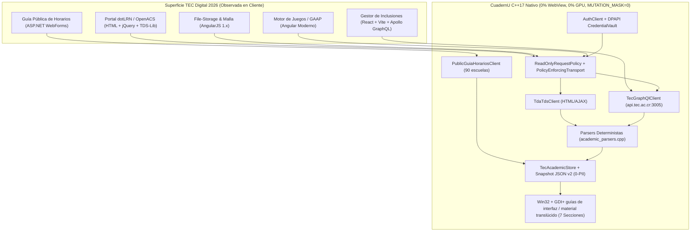

# Arquitectura Técnica Verificada de TEC Digital (2026)

> Todas las tecnologías listadas aquí se atribuyen **únicamente** por evidencia directa en HTML, encabezados HTTP y `198` bundles JS descargados del cliente. No se asume ni inventa infraestructura interna del servidor no observable.

## 1. Topología de Orígenes Observados

| Origen | Rol Observado | Autenticación | Tecnología Cliente Evidenciada |
|---|---|---|---|
| `https://tecdigital.tec.ac.cr` | Portal principal, cursos, cátedras, documentos, evaluaciones, expediente, rúbricas, plagio, prematrícula, ferias, modelo usuario | Cookies de sesión OpenACS/dotLRN | HTML servidor (OpenACS/dotLRN) + jQuery + TDS-Lib + AngularJS 1.x + React/Vite + Angular |
| `https://api.tec.ac.cr:3005/graphql` | API GraphQL del Gestor de Inclusiones y datos académicos consolidados | Bearer JWT (derivado de sesión) | Apollo GraphQL client en `tda-inclusion-manager/assets/index-IE6zhopY.js` |
| `https://tec-appsext.itcr.ac.cr/guiahorarios/` | Guía pública de horarios por escuela, verano y estudiante | Pública (sin sesión) | ASP.NET WebForms (`.aspx` WebMethods JSON) + jQuery DataTables |
| `https://api.tec.ac.cr:3003` | Servicio externo GAAP / Motor de Juegos | Token SPA separado (`HTTP 401` con cookies estándar) | Referenciado por `tda-motor-juegos` |

## 2. Stacks Frontend Evidenciados por Módulo

| Módulo | Tecnologías Comprobadas en Cliente |
|---|---|
| `ayuda_y_guias` | TDS-Lib (TEC Digital UI), Vanilla JS, dotLRN / OpenACS, jQuery |
| `calendario` | dotLRN / OpenACS, jQuery |
| `consentimiento_informado` | TDS-Lib (TEC Digital UI), jQuery |
| `control_plagio` | TDS-Lib (TEC Digital UI), Vanilla JS, Visualization/Export Lib, jQuery |
| `documentos_file_storage` | AngularJS 1.x, TDS-Lib (TEC Digital UI), dotLRN / OpenACS, jQuery |
| `evaluaciones` | TDS-Lib (TEC Digital UI), Visualization/Export Lib, dotLRN / OpenACS, jQuery |
| `expediente_estudiantil` | TDS-Lib (TEC Digital UI), Vanilla JS, Visualization/Export Lib, jQuery |
| `feria_negocios` | TDS-Lib (TEC Digital UI), jQuery |
| `gestor_inclusiones` | GraphQL Client, React (Vite SPA), Visualization/Export Lib, dotLRN / OpenACS |
| `gestor_inscripcion` | TDS-Lib (TEC Digital UI), Visualization/Export Lib, jQuery |
| `libreria_tds_lib` | TDS-Lib (TEC Digital UI), Vanilla JS, Visualization/Export Lib, jQuery |
| `malla_curricular` | AngularJS 1.x, TDS-Lib (TEC Digital UI), Vanilla JS, jQuery |
| `mensajeria_sms` | TDS-Lib (TEC Digital UI), jQuery |
| `modelo_usuario` | TDS-Lib (TEC Digital UI), Vanilla JS, Visualization/Export Lib, jQuery |
| `motor_juegos_gaap` | Visualization/Export Lib, dotLRN / OpenACS, jQuery |
| `notificaciones` | TDS-Lib (TEC Digital UI), Vanilla JS, jQuery |
| `otros_plataforma` | dotLRN / OpenACS, jQuery |
| `portal_dotlrn` | TDS-Lib (TEC Digital UI), Vanilla JS, dotLRN / OpenACS, jQuery |
| `prematricula` | TDS-Lib (TEC Digital UI), Visualization/Export Lib, jQuery |
| `rubricas` | TDS-Lib (TEC Digital UI), Vanilla JS, Visualization/Export Lib, jQuery |
| `sincronizacion_dar` | dotLRN / OpenACS, jQuery |

## 3. Diagrama de Arquitectura y Frontera de Seguridad

## 4. Responsividad Escritorio vs. Móvil (Observada en HTML)

- Clases responsivas detectadas en 500 páginas: `{"menu-left": 231}`.
- **Diferencia crítica escritorio/móvil:** El cajón móvil (`.menu-left`) expone un enlace directo `Ir a Mis documentos` (`/dotlrn/file-storage/#/<personal_id>`) fuera de `#header-td`. Los parsers deben priorizar `$rootScope.GL_FOLDER_ID` dentro del contenido principal para no mezclar carpetas personales con carpetas de cursos o cátedras.
