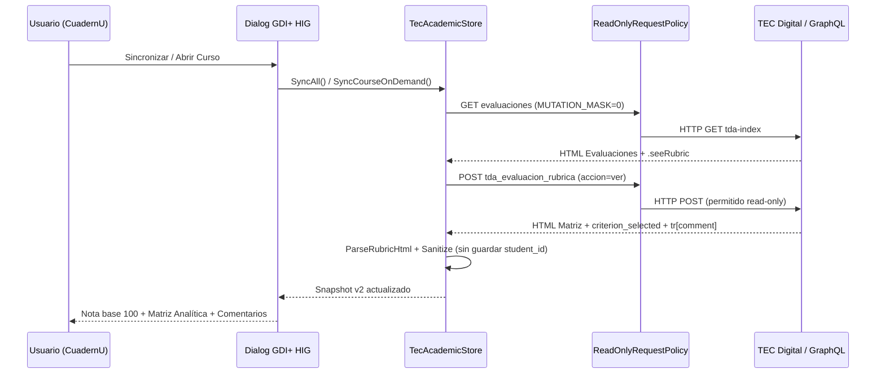

# Ingeniería del Flujo de Datos — TEC Digital ↔ CuadernU

## 1. Cadena Completa por Funcionalidad Principal

### 1.1 Autenticación y Recuperación de Sesión
`Acción usuario (Iniciar sesión)` → `Diálogo CuadernU` → `IDC_BTN_LOGIN` → `TecAcademicStore::LoginWithPassword` → `AuthClient::Login` (`POST /register/`) → `Cookies de sesión + DPAPI CredentialVault` → `TecAcademicStore::TryRestoreVaultSession` → `Actualización UI`.
- **Expiración de sesión:** Cualquier `HTTP 302 -> /register/` o formulario de login (excluyendo el modal oculto `#timeout-overlay` de `theme-td`) marca `session_expired` y notifica al usuario sin perder el caché local v2.
- **Sin conexión:** CuadernU carga `academic_snapshot.json` v2 + `global_horarios_2026.json` en <50 ms y muestra todos los datos cacheados en modo offline.

### 1.2 Evaluaciones (Nota Base 100 + %) y Sincronización Automática de Rúbricas
`Sincronización (SyncAll / abrir curso)` → `TecAcademicStore::SyncCourseOnDemand` → `TdaTdsClient::GetDetailedCourseEvaluations` (`GET <curso>/evaluation/tda-ce-estudiante/tda-index`) → `ParseDetailedEvaluationsHtml` (extrae ``, `.vt_grade_student` `earned/weight`, `"Nota obtenida: X / 100"`, `ComputeEvaluationGrade100`, y metadatos `.seeRubric` incluyendo `student_id` en RAM) → **Automáticamente por cada ítem con `has_rubric && !rubric_id.empty()`**: `TdaTdsClient::GetRubricBreakdown` (`POST /tda-rubrica/tda_evaluacion_rubrica`, `accion=ver`) → `ParseRubricHtml` (pesos `Peso X%`, celdas `td.criterion_selected`, fórmula `calculate_score()`, comentarios `tr[comment]`) → `TecAcademicStore` (`rubricsByKey` en RAM + `academic_snapshot.json` v2 **sin persistir `student_id`**) → `PaintCourseDetailCanvas` (píldoras verde/rojo base 100 + matriz analítica guías de interfaz con comentarios inline).
- **Sin rúbrica / sin calificar:** Muestra `"Pendiente"` + botón de simulación What-If (`70 / 85 / 100`).
- **Error de red / HTTP 404:** Conserva el caché previo del curso sin borrar evaluaciones ya guardadas.

### 1.3 Expediente, Promedio Ponderado, Horario Oficial y Citas
`SyncAll` → `TdaTdsClient::GetExpedienteSummary` (`#carne_expediente` en RAM + `detalle_notas` 9 cols + `generar_tabla_promedio_ponderado` + `detalle_historial` + `citas_matricula` sin `<tr>` + `info_personal` + `actualizar_cursos` preview + `tabla_horario` 4 secciones `'-----'`) + `TecGraphQlClient::FetchAcademicHistoryFull` (`44+` notas + `statistics`) + `FetchStudentGeneralInfo` (`rn[]`) + `FetchPendingGraduationCourses` → Fusión sin pérdida (GraphQL completa el historial multi-semestre si `detalle_notas` solo devuelve el periodo activo) → `SaveSnapshotToDisk` v2 → `PaintExpStatsCanvas` (gráfico vectorial ponderado, tabla 44+ notas, alertas RN, citas, 8 estados oficiales).

### 1.4 Documentos, Cátedras y Biblioteca Offline
`Seleccionar curso/cátedra` → `GET <espacio>/file-storage/` → Extracción de `$rootScope.GL_FOLDER_ID` → `GET /dotlrn/file-storage/api/folder/{id}` (recursivo acotado) → Descarga opcional verificada por SHA-256 → Índice FTS5 SQLite (`OfflineMaterialIndex`) → Búsqueda instantánea offline en **Biblioteca Offline** e inserción directa al lienzo de CuadernU.

### 1.5 Buscador Global de Horarios (Todo el TEC)
`Indexar todo el TEC` → `PublicGuiaHorariosClient::FetchAllEscuelasByYear(2026)` (90+ escuelas concurrentes, `tec-appsext.itcr.ac.cr/guiahorarios/`) → `GlobalHorariosIndex` (`1,361+` cursos, `4,635+` grupos, `5` sedes) + enriquecimiento de aulas/cupos desde Expediente → Persistencia `global_horarios_2026.json` → Búsqueda <1 ms + `HorariosTec` Solver sin choques.

### 1.6 Control de Plagio, Modelo de Usuario, Ferias y Notificaciones
`SyncAll` → `cargaArbol` + `cargaMisDocs` + `cargaDocsCurso` (`tda-control-plagio`), 10 secciones HTML `tda-um/ajax/get_info`, `#tferias` (`tda-feria-negocios`), `api/forms` + `api/evaluations` (`tda-performance-evaluation`), `get_user_notifications` + `/notifications/manage` → `SaveSnapshotToDisk` v2 → `PaintTramitesCanvas` (5 sub-segmentos guías de interfaz).
- **Acciones mutantes (Subir entrega, Eliminar revisión, Marcar/Eliminar notificación, Sincronizar DAR):** Bloqueadas con `MUTATION_MASK=0`; requieren diálogo modal de confirmación explícita del usuario que activa un `ScopedUserMutationGuard` RAII para esa única petición.

